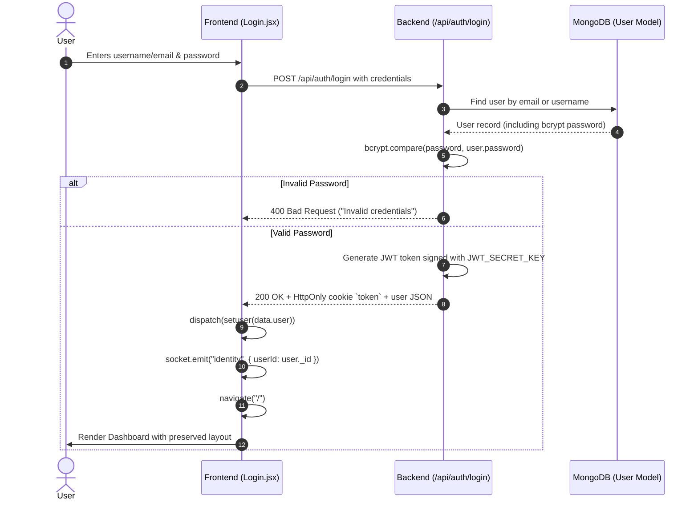
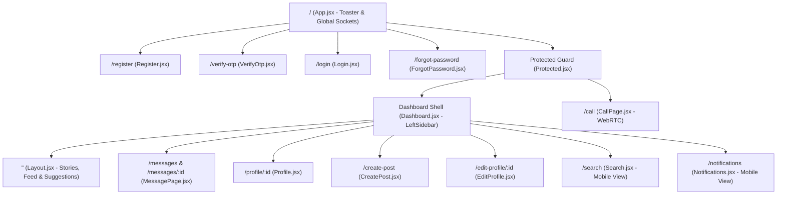

# AI.md — Main AI Assistant Instructions & Project Context

> **CRITICAL DIRECTIVE FOR ALL AI CODING ASSISTANTS:**
> You must thoroughly read this file (`AI.md`), along with `WORKFLOW.md`, `ARCHITECTURE.md`, and `TASK_TRACKER.md`, **before inspecting or altering any code**.
> Always maintain the established architecture, component hierarchy, Poppins typography, dvh viewport standards, and visual aesthetics defined herein.

---

## 1. Project Overview & Purpose

**Lime** (also known as **C Lime**) is a modern, responsive full-stack social media and real-time community networking web application. Designed around a sleek, dark-first citrus aesthetic (accented by neon lime `#84cc16`), Lime enables creators and users to:
* Publish multi-photo galleries (up to 10 photos with client-side canvas rotation) and short video clips (up to 60 seconds).
* Share 24-hour disappearing Stories with progress indicators and real-time viewers.
* Engage via instant direct messaging (real-time chat with delivery/read receipts, media attachments, and message deletion).
* Conduct peer-to-peer WebRTC video and audio calls with in-call camera/microphone toggling.
* Receive real-time push and in-app notifications for likes, comments, and new followers.
* Personalize profiles, follow creators, toggle light/dark themes, and manage privacy.

---

## 2. Website Features & Functionality

### A. Authentication & User Management
* **Dual-Method Auth**: Standard email/username + bcrypt password authentication alongside OAuth 2.0 (Google & GitHub via Passport.js).
* **Email Verification & OTP**: 6-digit OTP verification upon signup and password resets via Nodemailer.
* **Persistent Sessions**: HttpOnly, secure JWT cookies (`token`) storing signed user identifiers.
* **Protected Routes & Outlets**: Granular client-side route guard (`Protected.jsx`) with animated splash screen during initial authentication rehydration.

### B. Feed, Posts & Stories
* **Dynamic Feed Filtering**: Dual-tab home feed separating "For You" (global community discovery) and "Following" (curated posts from followed creators).
* **Rich Media Publishing**:
  * **Images**: Multi-photo upload (up to 10 images) with interactive thumbnail strip and 90° clockwise canvas-based image rotation.
  * **Short Videos**: 60-second video uploads with duration validation, client-side metadata inspection, and custom overlay controls.
* **Interactive Engagement**: Optimistic liking, nested comment threads with deletion/report mechanisms, and post bookmarking.
* **24-Hour Stories**: Horizontal story bar supporting image and video stories with automatic 24-hour TTL expiration.

### C. Direct Messaging & Real-Time Communication
* **Instant Chat**: One-on-one direct conversations with Socket.IO real-time bi-directional messaging.
* **Media Sharing**: Direct photo and video uploads inside messages with thumbnail lightbox zoom.
* **Message Receipts**: Granular message status tracking (`sent` -> `delivered` -> `read`).
* **Multi-Select & Bulk Actions**: Select multiple messages to delete for oneself or delete for everyone (sender-only).
* **Unread Indicators**: Real-time unread conversation counts updated globally in the Redux store and sidebar badge.

### D. WebRTC Audio & Video Calling
* **Calling Signaling**: Socket.IO signaling service coordinating `call-user`, `incoming-call`, `call-response`, `signal` (SDP offer/answer and ICE candidates), and `hang-up`.
* **Incoming Call Modal**: Global overlay with audio/video indicator, pulsing avatar rings, and accept/decline triggers.
* **Call Page**: Picture-in-picture local stream, full remote stream, elapsed duration timer, mute/unmute microphone, and camera toggle.

### E. Notifications Drawer
* **Docked Flyout Drawer**: Clean slide-out panel docked adjacent to the desktop left sidebar (`left: 240px; width: 390px; height: 100dvh;`).
* **Category Filtering**: Filter pills for `All`, `Likes`, `Comments`, and `Follows`.
* **Status Controls**: Mark all notifications as read, individual notification deletion, and click-through navigation to relevant posts or user profiles.
* **Empty State**: Centered green bell illustration and descriptive copy matching original visual guidelines.

---

## 3. Technology Stack & Package Versions

### Frontend (`/FrontEnd`)
| Package | Version | Purpose |
| :--- | :--- | :--- |
| `react` | `^19.2.6` | Modern UI library with concurrent rendering |
| `react-dom` | `^19.2.6` | DOM bindings for React |
| `vite` | `^8.0.12` | Lightning-fast ESM bundler & dev server |
| `react-router-dom` | `^7.18.0` | Client-side routing with `createBrowserRouter` |
| `@reduxjs/toolkit` | `^2.12.0` | Scalable state management |
| `react-redux` | `^9.3.0` | React bindings for Redux Toolkit |
| `socket.io-client` | `^4.8.3` | Real-time WebSockets connection |
| `axios` | `^1.18.0` | Promise-based HTTP client with credentials |
| `sass` | `^1.101.0` | Modern Sass/SCSS stylesheet preprocessor |
| `lucide-react` | `^1.35.0` | Consistent minimalist icon system |
| `react-hot-toast` | `^2.6.0` | Polished toast notification overlays |
| `react-spinners` | `^0.17.0` | Loading spinners and beat loaders |

### Backend (`/Backend`)
| Package | Version | Purpose |
| :--- | :--- | :--- |
| `express` | `^5.2.1` | REST API web server framework |
| `mongoose` | `^9.7.1` | MongoDB ODM with schema validation |
| `socket.io` | `^4.8.3` | WebSockets server for real-time messaging & WebRTC |
| `jsonwebtoken` | `^9.0.3` | Signed token authentication |
| `bcrypt` / `bcryptjs` | `^6.0.0` | Cryptographic password hashing |
| `multer` | `^2.2.0` | Multi-part form-data media upload handling |
| `cloudinary` | `^2.10.0` | Cloud-hosted media storage & transformations |
| `sharp` | `^0.35.1` | High-performance image resizing & optimization |
| `nodemailer` | `^9.0.5` | Transactional email & OTP delivery |
| `passport` | `^0.7.0` | Google & GitHub OAuth 2.0 authentication |
| `cookie-parser` | `^1.4.7` | Signed HttpOnly cookie parsing |
| `dotenv` | `^17.4.2` | Environment variable management |

---

## 4. Complete Project Folder Structure

```
C Lime/
├── AI.md                     # Primary AI Assistant Context & Rules (This file)
├── WORKFLOW.md               # End-to-end development workflows & Mermaid charts
├── TASK_TRACKER.md           # Completed, in-progress, and pending task ledger
├── CHANGELOG.md              # Chronological history of all architectural changes
├── ARCHITECTURE.md           # Deep technical architecture & component maps
├── Backend/
│   ├── config/
│   │   ├── database.js       # MongoDB Mongoose connection
│   │   ├── githubStrategy.js # Passport GitHub OAuth configuration
│   │   └── googleStrategy.js # Passport Google OAuth configuration
│   ├── controllers/
│   │   ├── auth.controller.js         # Register, Login, Logout, OTP & Password
│   │   ├── message.controller.js      # Direct chat messages, media & unread count
│   │   ├── notification.controller.js # Notifications generation & status
│   │   ├── post.controller.js         # Posts CRUD, likes, comments & bookmarks
│   │   ├── project.controller.js      # Project management utility controller
│   │   ├── story.controller.js        # 24-hour stories creation & expiration
│   │   └── user.controller.js         # User profiles, follow/unfollow & search
│   ├── middleware/
│   │   ├── isAuth.js         # JWT cookie validation & req.userId attachment
│   │   └── multer.js         # In-memory buffer media upload middleware
│   ├── models/
│   │   ├── admin.model.js
│   │   ├── comment.model.js
│   │   ├── convertation.js   # Conversation participants & messages
│   │   ├── message.model.js  # Message text, media attachments & receipts
│   │   ├── notification.model.js
│   │   ├── pendingSignup.model.js # Pre-verified user registrations with OTP
│   │   ├── post.model.js     # Post media (images/videos), likes & comments
│   │   ├── report.model.js   # Moderation report schema
│   │   ├── story.model.js    # Disappearing stories schema
│   │   └── user.model.js     # User document schema
│   ├── routes/
│   │   ├── auth.route.js
│   │   ├── message.route.js
│   │   ├── notification.route.js
│   │   ├── post.route.js
│   │   ├── story.route.js
│   │   └── user.route.js
│   ├── services/
│   │   └── socket.service.js # Socket.IO identity, messaging & WebRTC signaling
│   ├── utils/
│   │   ├── cloudinary.js     # Cloudinary uploader utility
│   │   ├── mail.js           # Nodemailer transport
│   │   ├── mediaStorage.js   # Unified local storage or Cloudinary fallback
│   │   ├── token.js          # JWT signing and cookie generation
│   │   └── templates/        # Responsive HTML email templates
│   ├── server.js             # HTTP & Socket.IO server initialization
│   ├── package.json
│   └── .env
└── FrontEnd/
    ├── index.html            # Loads Google Poppins font family
    ├── vite.config.js
    ├── package.json
    └── src/
        ├── App.jsx           # Root layout, global hooks, socket sync & toasts
        ├── config.js         # API URL & getMediaUrl resolution
        ├── main.jsx          # React DOM root & Provider initialization
        ├── socket.js         # Singleton Socket.IO client instance
        ├── assets/           # Logos, icons, and local font files
        ├── components/
        │   ├── ChatBox.jsx           # Active chat window with audio/video buttons
        │   ├── ChatList.jsx          # Conversations sidebar list
        │   ├── CommentModel.jsx      # Post comments modal
        │   ├── CreatePost.jsx        # 2-column post creator (Image 2 design)
        │   ├── CustomVideoPlayer.jsx # Clean HTML5 video player with controls
        │   ├── EditProfile.jsx       # Profile avatar, bio & name updater
        │   ├── FollowersModal.jsx    # Follower list modal
        │   ├── FollowingModel.jsx    # Following list modal
        │   ├── IncomingCallModal.jsx # WebRTC incoming call dialog
        │   ├── LeftSidebar.jsx       # Fixed desktop/tablet navigation sidebar
        │   ├── MessagePage.jsx       # Chat split-screen view
        │   ├── Notifications.jsx     # Notifications flyout drawer (Image 1 design)
        │   ├── Post.jsx              # Feed post card with carousel & actions
        │   ├── Posts.jsx             # Feed tab filter and posts collection
        │   ├── Profile.jsx           # User profile grid and header
        │   ├── RightSideBar.jsx      # Suggested users widget
        │   ├── Search.jsx            # User search flyout drawer
        │   ├── StoriesBar.jsx        # Top 24h stories circular avatars
        │   └── StoryViewer.jsx       # Fullscreen story viewer modal
        ├── context/
        │   └── AuthContext.jsx
        ├── hooks/
        │   ├── useGetMyLikes.jsx
        │   ├── useGetMySuggestions.jsx
        │   ├── useGetPosts.jsx
        │   ├── useGetUser.jsx
        │   └── useGetUserPosts.jsx
        ├── layouts/
        │   └── Layout.jsx            # Main central feed + right sidebar layout
        ├── pages/
        │   ├── CallPage.jsx          # Dedicated WebRTC audio/video call screen
        │   ├── Dashboard.jsx         # App shell containing LeftSidebar & Outlet
        │   ├── ForgotPassword.jsx    # Password recovery page
        │   ├── Login.jsx             # User login page
        │   ├── Register.jsx          # User registration page
        │   └── VerifyOtp.jsx         # OTP verification page
        ├── routes/
        │   ├── index.jsx             # React Router createBrowserRouter config
        │   └── Protected.jsx         # Auth guard & splash screen loader
        ├── services/
        │   └── api.js                # Reusable Axios service instance
        ├── store/
        │   ├── store.js              # Redux Toolkit store config
        │   └── user.slice.js         # Global user, feed, theme & notification state
        └── styles/
            ├── auth.scss             # Login/Register card styles
            ├── call.scss             # WebRTC CallPage styles
            ├── commentModel.scss     # Comments modal styles
            ├── common.scss           # Shared buttons, dialogs & overlays
            ├── createPost.scss       # Create Post 2-column styles (Image 2)
            ├── customVideoPlayer.scss# Video player styles
            ├── dashboard.scss        # Shell, LeftSidebar & RightSideBar styles
            ├── editProfile.scss      # Edit profile form styles
            ├── index.scss            # Master stylesheet bundle
            ├── message.scss          # ChatBox & ChatList styles
            ├── mixin.scss            # Reusable Sass mixins
            ├── notifiaction.scss     # Notifications drawer styles (Image 1)
            ├── posts.scss            # Post card, actions & carousel styles
            ├── profile.scss          # Profile page grid & bio styles
            ├── reset.scss            # Global reset & Poppins typography root
            ├── search.scss           # Search drawer styles
            └── variable.scss         # Color tokens, radii & theme variables
```

---

## 5. Frontend Architecture

### Core Design Principles
1. **Unidirectional State Flow**: Global state resides in Redux Toolkit (`user.slice.js`). Components dispatch actions to modify state; socket events and data hooks trigger synchronized updates.
2. **Nested Outlets**: `App.jsx` serves as root wrapper. `Protected.jsx` verifies authentication before rendering `Dashboard.jsx`. `Dashboard.jsx` locks `LeftSidebar` in place while rendering page views inside `<main className="main-content-area"><Outlet /></main>`.
3. **No Layout Shifts After Login**: The desktop sidebar has a fixed width (`240px`), sticky positioning (`top: 0; height: 100dvh;`), and does not distort the central feed column.
4. **Docked Flyout Panels**: Panels such as Search and Notifications dock at `position: fixed; left: 240px; top: 0; width: 390px; height: 100dvh;` without disrupting feed content.
5. **Mobile First Responsive Layering**:
   * Desktop (> 1080px): Left Sidebar (240px) + Main Feed (max 630px) + Right Sidebar (320px).
   * Tablet (641px - 1080px): Compact Icon Sidebar (76px) + Main Feed. Right Sidebar is hidden.
   * Mobile (≤ 640px): Sidebar hidden. Mobile Top Header (with Lime brand & shortcuts) + Central Outlet + Mobile Bottom Navigation Bar (56px).

---

## 6. Backend Architecture

### Design Standards
1. **RESTful Routing**: Structured resource routes prefixed with `/api/...` (`/api/auth`, `/api/user`, `/api/post`, `/api/message`, `/api/story`, `/api/notifications`).
2. **Middleware Hierarchy**:
   * Request logging & body parsing (`express.json({ limit: "100mb" })`, `cookieParser()`).
   * Authentication barrier (`isAuth.js`) decrypts signed JWT tokens from cookies and binds `req.userId`.
   * Multipart uploads processed via `multer` memory storage before passing to `mediaStorage.js`.
3. **Hybrid Media Storage**: `mediaStorage.js` uploads files to Cloudinary if configured; otherwise, it writes to local `/uploads/` and serves files through `express.static`.
4. **Real-Time Integration**: Socket.IO is initialized on the same HTTP server instance (`server.js`) and exports `getIO()` and `getReceiverSocketId()` to controllers for instant broadcasts.

---

## 7. Authentication Workflow



---

## 8. Redux Store Architecture (`user.slice.js`)

State Shape:
```typescript
interface UserState {
  user: UserObject | null;
  loading: boolean;
  theme: "dark" | "light";
  posts: PostObject[];
  userPosts: PostObject[];
  myLikes: PostObject[];
  myBookmarks: string[];
  mySuggestions: UserObject[];
  notifications: NotificationObject[];
  unreadNotificationsCount: number;
  unreadMessagesCount: number;
  activeStories: StoryObject[];
}
```

Key Reducer Actions:
* `setuser(userData)`: Hydrates user object and resets auxiliary caches upon logout.
* `resetUserState()`: Fully resets store to initial state on logout.
* `toggleTheme()`: Toggles between `"dark"` and `"light"`, updates `localStorage`, and sets `<html data-theme="...">`.
* `addNewPost(post)`: Prepends newly created post to the feed without a full page reload.
* `removePost(postId)`: Removes deleted post from both global feed and user profile feed.
* `updatePostLikesInFeed({ postId, userId })`: Optimistically updates post likes.
* `setUnreadMessagesCount(count)`: Updates global direct message badge.
* `addNotification(notif)`: Real-time notification prepend with unread count increment.
* `markAllNotificationsReadInStore()`: Zeroes unread notification counter.

---

## 9. React Router & Outlet Architecture



---

## 10. API Endpoints Reference

### Auth (`/api/auth`)
* `POST /signup`: Validate input and dispatch 6-digit verification OTP.
* `POST /verify-otp`: Validate signup OTP and persist user in DB.
* `POST /login`: Authenticate user and issue HttpOnly JWT token.
* `GET /logout`: Invalidate session and clear `token` cookie.
* `POST /forgot-password`: Send password reset OTP email.
* `POST /verify-reset-otp`: Verify reset code.
* `POST /reset-password`: Set new hashed password.

### Users (`/api/user`)
* `GET /user`: Fetch authenticated user profile.
* `GET /profile/:id`: Retrieve public profile of specified user.
* `POST /edit-profile`: Update bio, profile image, name, or gender.
* `POST /follow-or-unfollow/:id`: Toggle follow status for target user.
* `GET /suggested`: Retrieve 5 suggested accounts to follow.
* `GET /search?search=:term`: Search users by username or full name.

### Posts (`/api/post`)
* `POST /add-post`: Upload photos/video, apply rotations, and save post.
* `POST /convert-preview`: Convert non-native image formats (HEIC, TIFF, RAW, etc.) to instant JPEG preview data URL.
* `GET /posts`: Fetch home feed posts (supports `?filter=following`).
* `GET /user-posts/:id`: Fetch all posts published by specific user.
* `POST /:id/like`: Like target post and generate notification.
* `POST /:id/dislike`: Remove like from post.
* `POST /:id/comment`: Add comment to post.
* `DELETE /comment/:commentId`: Delete comment.
* `POST /:id/bookmark`: Save post to bookmarks.
* `DELETE /delete-post/:id`: Delete post and associated media.

### Messages (`/api/message`)
* `GET /conversations`: Fetch all user conversations with unread counts.
* `POST /conversation/:id`: Get or create conversation with target user.
* `GET /messages/:id`: Fetch message history with target user.
* `POST /send/:id`: Send message with optional photo/video attachment.
* `PUT /read/:id`: Mark conversation messages as read.
* `GET /unread-count`: Fetch global unread conversation count.
* `DELETE /delete`: Delete selected messages (for self or everyone).

### Notifications (`/api/notifications`)
* `GET /`: Retrieve notifications list and unread count.
* `PUT /read-all`: Mark all notifications as read.
* `PUT /:id/read`: Mark single notification as read.
* `DELETE /:id`: Delete notification.

---

## 11. Design System & Typography Rules

1. **Typography**:
   * Primary Font: **`Poppins`**, sans-serif throughout the application.
   * Google Font weights: `300` (Light), `400` (Regular), `500` (Medium), `600` (Semi-Bold), `700` (Bold), `800` (Extra-Bold).
   * Monospace: `ui-monospace, Consolas, monospace` for timestamps or counters.
2. **Viewport Units**:
   * Always use **`dvh`** instead of `vh` for viewport height styling (`100dvh`, `90dvh`, etc.) to eliminate mobile browser address bar clipping.
3. **Color Palette**:
   * **Primary Lime Brand**: `#84cc16` (Lime 500), Hover: `#a3e635`.
   * **Active Nav Pill Tint**: `rgba(132, 204, 22, 0.16)` with border `rgba(132, 204, 22, 0.28)`.
   * **Dark Background**: `#09090b` (App), `#101012` (Surface/Sidebar), `#18181b` (Card).
   * **Borders**: `#27272a` (Subtle), `#3f3f46` (Strong).
   * **Text**: `#f4f4f5` (Primary), `#a1a1aa` (Secondary), `#71717a` (Muted).
   * **Danger / Logout Hover**: `#ef4444`, background: `rgba(239, 68, 68, 0.12)`.
4. **Visual Guidelines (Per User Screenshots)**:
   * **Screenshot 1**: Left sidebar with Lime citrus icon + "Lime" text, active nav items as rounded green pills (`background: rgba(132, 204, 22, 0.16); color: #84cc16`), profile circular avatar (with "US" blue circle fallback), Light/Dark mode switcher, and distinguishable logout button. Docked notifications drawer immediately to the right (`left: 240px; width: 390px; height: 100dvh;`) with "Notifications" title, 'X' close button, filter tabs ("All", "Likes", "Comments", "Follows"), and centered circular green bell empty state.
   * **Screenshot 2**: "Create New Post" modal with Back arrow, centered title, and lime green "Share Post" pill button (`background: #84cc16; color: #000; border-radius: 9999px; font-weight: 700`). Left side: media preview with video controls and bottom-centered overlaid `X Remove` pill button (`background: rgba(20, 20, 20, 0.88); color: #ef4444; border-radius: 9999px`). Right side: circular avatar + "@Geetaish", caption textarea with "0/1000" counter, and "Lime Posting Guidelines" card with green sparkle icon.

---

## 12. Mandatory Rules for Any AI Assistant

Every AI assistant working on this codebase must adhere strictly to these rules:
1. **Read Before Modifying**: Read `AI.md`, `WORKFLOW.md`, `TASK_TRACKER.md`, and `ARCHITECTURE.md` before changing any code.
2. **Inspect Existing Files**: Always inspect target components and related SCSS stylesheets before assuming classes or markup.
3. **Preserve Working Logic**: The authentication system, JWT tokens, WebSockets, and database schemas are fully operational. Do not rewrite working logic.
4. **Follow Design Specs**: Never introduce arbitrary fonts, random colors, or unrequested UI components. Adhere strictly to Poppins typography and the lime visual design.
5. **Enforce `dvh` Standard**: Viewport-height values must use `dvh`, never standard `vh`.
6. **Keep Documentation Synchronized**: After completing any task or bug fix, update `TASK_TRACKER.md` and `CHANGELOG.md`.

---
*End of AI.md — Refer to WORKFLOW.md for development workflows.*
