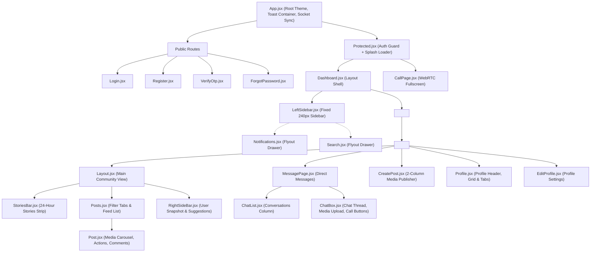
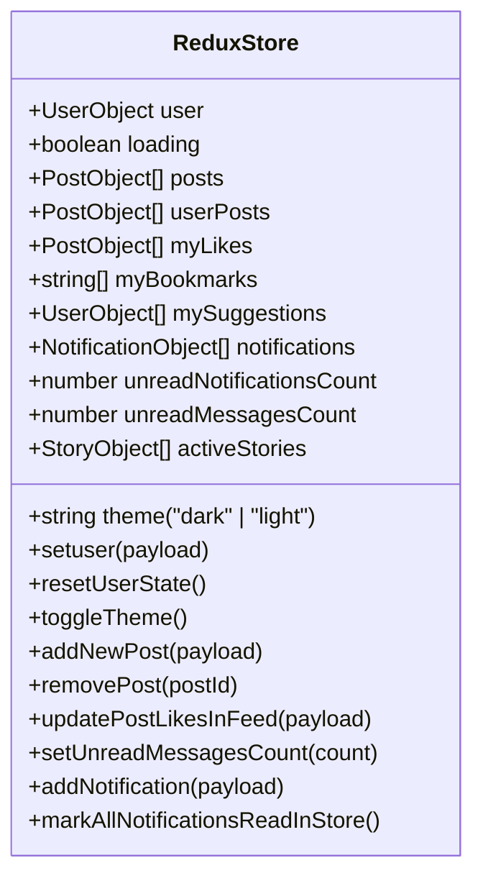
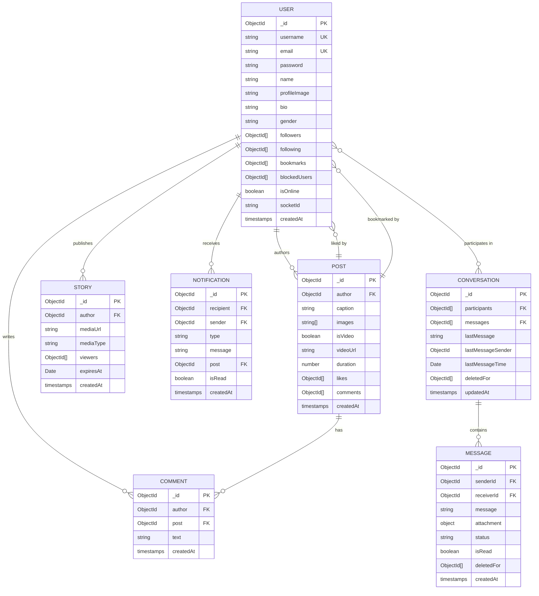
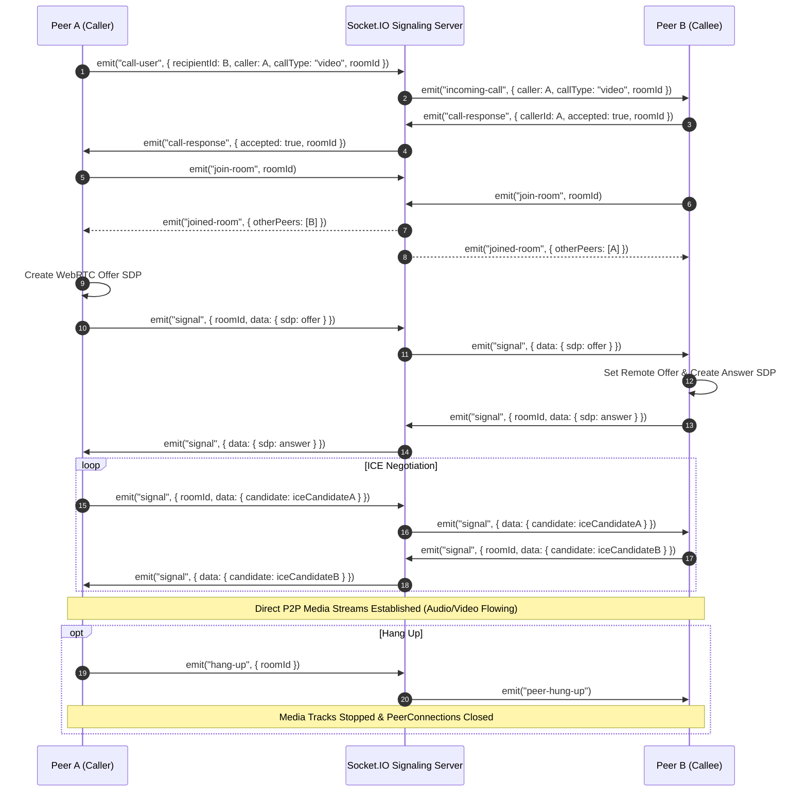

# ARCHITECTURE.md — Technical Architecture Blueprint

This document details the complete technical architecture of the **Lime** full-stack application, outlining system boundaries, communication protocols, state design, database schemas, and real-time coordination.

---

## 1. Overall Application Architecture

```mermaid
graph TB
    subgraph ClientLayer ["Client Layer (React 19 + Vite)"]
        BrowserUI["User Browser / Mobile PWA"]
        ReactRouter["React Router 7 (createBrowserRouter)"]
        ReduxStore["Redux Toolkit Global Store (user.slice.js)"]
        SocketClient["Socket.IO Client Singleton (socket.js)"]
        WebRTCClient["WebRTC RTCPeerConnection"]
    end

    subgraph GatewayLayer ["Network & Security Gateway"]
        CORS["CORS Policy (localhost:5173 / credentials: true)"]
        CookieGuard["HttpOnly Signed JWT Cookie ('token')"]
        RateLimiter["Body Parser Limit: 100MB"]
    end

    subgraph ServerLayer ["Backend Application Server (Express 5 + Node.js)"]
        AuthModule["Auth Controller & Passport.js"]
        UserModule["User & Follow Controller"]
        PostModule["Post, Like & Comment Controller"]
        MsgModule["Message & Conversation Controller"]
        NotifModule["Notification Controller"]
        SocketServer["Socket.IO Real-Time & Signaling Hub"]
        MediaService["mediaStorage.js (Sharp + Memory Buffer)"]
    end

    subgraph StorageLayer ["Persistence & Cloud Storage"]
        MongoDB[(MongoDB Database)]
        Cloudinary[(Cloudinary Media Storage)]
        LocalStorage[(Local /uploads/ Disk Storage)]
    end

    BrowserUI --> ReactRouter
    ReactRouter --> ReduxStore
    BrowserUI --> SocketClient
    BrowserUI --> WebRTCClient

    BrowserUI -->|HTTPS / Axios| GatewayLayer
    SocketClient <-->|WebSockets (Port 5000)| SocketServer
    WebRTCClient <-->|P2P Media Stream| WebRTCClient

    GatewayLayer --> ServerLayer
    ServerLayer --> MongoDB
    MediaService --> Cloudinary
    MediaService --> LocalStorage
```

---

## 2. Frontend & Backend Communication Protocols

1. **REST API (HTTP/1.1 & HTTP/2)**:
   * **Payload Format**: `application/json` for standard queries and mutations; `multipart/form-data` for photo galleries and video uploads.
   * **Credential Handling**: All client requests set `{ withCredentials: true }` to transmit the signed `token` HttpOnly cookie automatically.
   * **Response Structure**:
     ```json
     {
       "success": true,
       "message": "Human-readable status",
       "data": {}
     }
     ```
2. **WebSockets (Socket.IO v4)**:
   * Transport: Automatic negotiation (`websocket` preferred, `polling` fallback).
   * Event Channels:
     * `identity`: Client establishes identity with `{ userId }`.
     * `newMessage`: Direct message delivery.
     * `unreadMessageCount`: Updates unread message counter globally.
     * `notification`: Real-time like, comment, or follow alert.
     * `call-user` / `incoming-call` / `call-response` / `signal` / `hang-up`: WebRTC audio/video call signaling.

---

## 3. Component Hierarchy & Layout Structure



---

## 4. Redux Store Architecture (`user.slice.js`)



---

## 5. Routing Hierarchy

```
/
├── register               (Public - Register.jsx)
├── verify-otp             (Public - VerifyOtp.jsx)
├── login                  (Public - Login.jsx)
├── forgot-password        (Public - ForgotPassword.jsx)
└── [Protected Guard]      (Protected.jsx)
    ├── call               (Protected - CallPage.jsx)
    └── [Dashboard Shell]  (Dashboard.jsx - LeftSidebar)
        ├── ''             (Index - Layout.jsx: StoriesBar + Posts + RightSideBar)
        ├── messages       (MessagePage.jsx)
        ├── messages/:id   (MessagePage.jsx with selected conversation)
        ├── profile/:id    (Profile.jsx)
        ├── create-post    (CreatePost.jsx - 2-Column Publishing View)
        ├── edit-profile/:id (EditProfile.jsx)
        ├── search         (Search.jsx - Dedicated route on mobile)
        └── notifications  (Notifications.jsx - Dedicated route on mobile)
```

---

## 6. Database Architecture & Schema Relationships



---

## 7. Real-Time Communication & WebRTC Signaling Architecture



---

## 8. Summary of Architectural Guarantees

* **Layout Isolation**: The left sidebar, notifications flyout drawer, and central content area are decoupled. The sidebar maintains a fixed width and sticky position (`top: 0; height: 100dvh;`), preventing any layout jump after user login.
* **Responsive Scaling**: Desktop (> 1080px), Tablet (641px - 1080px), and Mobile (≤ 640px) breakpoints provide dedicated layouts without overlapping elements or broken margins.
* **Unified State Resilience**: State updates occur optimistically on the client and reconcile via WebSockets and HTTP responses, ensuring instant user feedback while preserving consistency with MongoDB.
* **Universal Multi-Format Media Pipeline**: High-resolution and exotic image/video formats (HEIC, TIFF, RAW, MKV, AVI, etc.) are converted on-the-fly via backend `sharp` transcoders (`/api/post/convert-preview`) while maintaining resilient thumbnail format badges (`.thumb-fallback-badge`) on the client. Broken image placeholders and truncated alt-text are completely eliminated.
