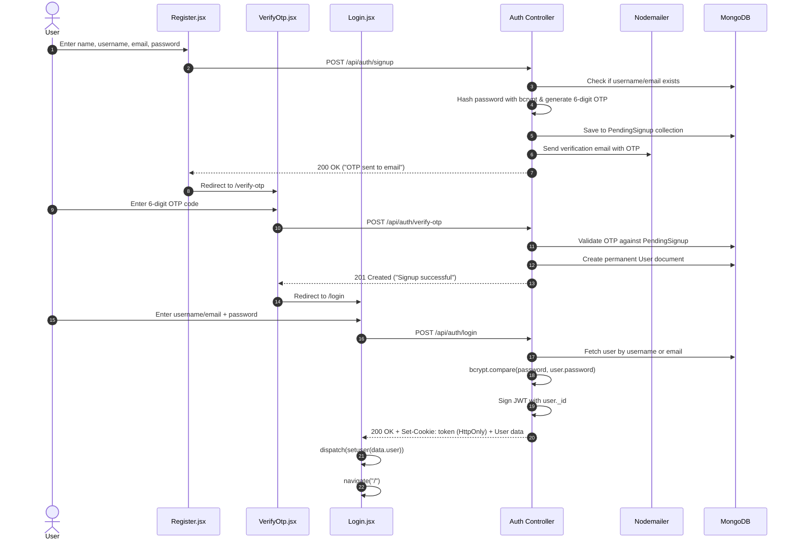
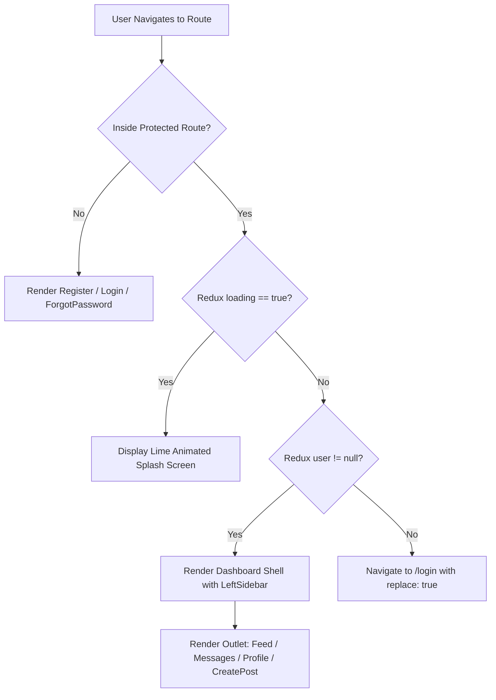
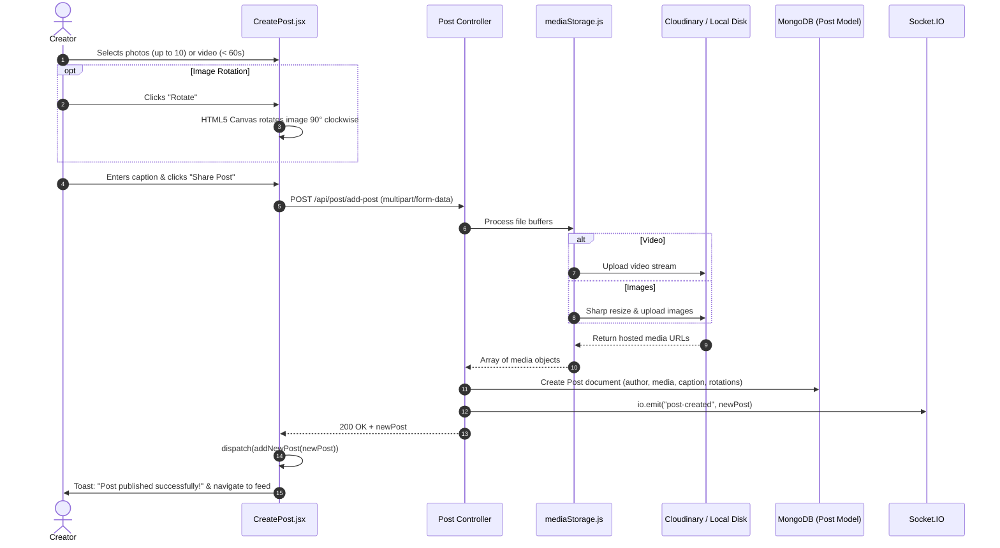
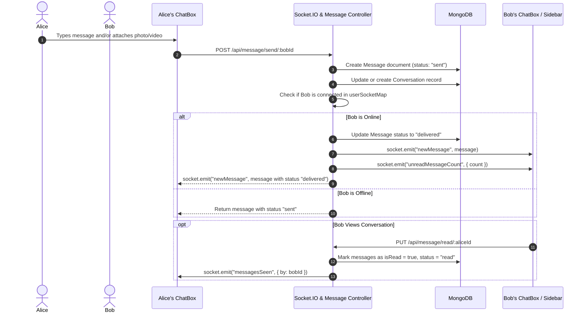
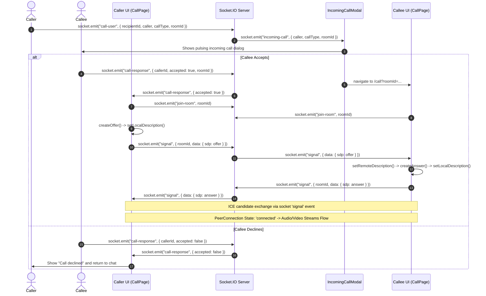
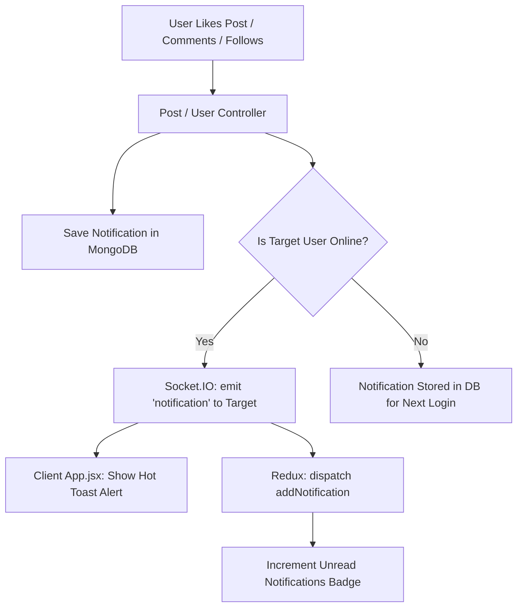
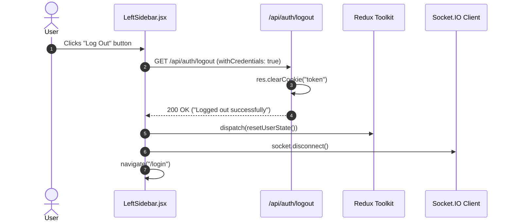
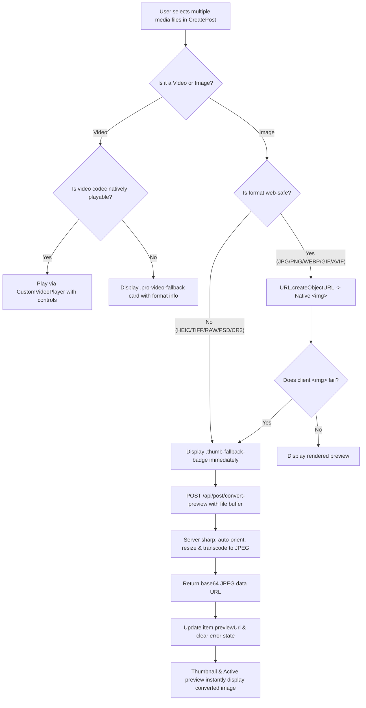

# WORKFLOW.md — Complete Application Workflows

This document details the complete end-to-end operational workflows of the Lime application across frontend, backend, database, and WebSockets layers.

---

## 1. Application Startup Workflow

```mermaid
flowchart TD
    Start([System Boot]) --> LoadEnv[Load Backend .env]
    LoadEnv --> ConnectDB[(Connect to MongoDB)]
    ConnectDB --> InitSocket[Initialize Socket.IO Server]
    InitSocket --> StartExpress[Start Express Server on Port 5000]
    
    StartExpress --> ClientStart[Start Vite Frontend on Port 5173]
    ClientStart --> MountApp[Mount React Root / App.jsx]
    MountApp --> CheckToken[useGetUser Hook fires GET /api/user/user]
    MountApp --> ConnectClientSocket[socket.connect() -> establish WS]
    
    CheckToken --> AuthCheck{Session Valid?}
    AuthCheck -- Yes --> SetUserStore[Redux: setuser(userData)]
    SetUserStore --> FetchFeeds[Trigger Feed, Suggestions & Notifications Hooks]
    SetUserStore --> IdentifySocket[Socket: emit 'identity' with userId]
    AuthCheck -- No --> ClearUserStore[Redux: setuser(null)]
    ClearUserStore --> RenderPublic[Display Login / Public Routes]
```

### Steps:
1. **Backend Initialization**: `server.js` loads environment variables, initializes database connectivity via Mongoose (`config/database.js`), configures passport strategies, attaches Socket.IO to the HTTP server via `initSocket`, and begins listening on `PORT` (default 5000).
2. **Frontend Boot**: Vite bundles and mounts `main.jsx` -> `App.jsx`.
3. **Session Rehydration**: `useGetUser.jsx` dispatches a request to `/api/user/user`. If the browser presents a valid signed `token` cookie, the backend deserializes the user and returns the user profile, setting `loading: false` in Redux.
4. **Socket Registration**: `socket.connect()` opens the real-time tunnel. Upon connection, if `user._id` exists, the client emits `identity` with the user ID, recording the socket connection in `userSocketMap`.

---

## 2. User Registration, OTP & Login Workflow



---

## 3. Protected Routing & Session Persistence Workflow



---

## 4. Redux Global State Management Workflow

```mermaid
flowchart LR
    Component[React Component] -->|User Interaction| Dispatch[dispatch(action)]
    SocketEvent[Socket.IO Event] -->|Incoming Data| Dispatch
    DataHook[Custom Data Hook] -->|Axios Response| Dispatch
    
    Dispatch --> SliceReducer[userSlice Reducer]
    SliceReducer --> StateUpdate[Updated Redux Store State]
    
    StateUpdate --> ReRender[Subscriber Components Re-render Optimistically]
    StateUpdate --> SyncAttr[Theme Sync: document.documentElement data-theme]
```

### Key Global Subscriptions:
* **Posts Feed**: Feed updates via `setPosts`, `addNewPost`, `removePost`, and `updatePostLikesInFeed`.
* **Badge Counters**: Unread messages badge (`unreadMessagesCount`) and notifications badge (`unreadNotificationsCount`) update in real time.
* **Theme Switching**: `toggleTheme()` updates both the Redux store and the DOM `data-theme` attribute for instant stylesheet recoloring.

---

## 5. Post Publishing & Media Handling Workflow



---

## 6. Direct Chat & Real-Time Messaging Workflow



---

## 7. WebRTC Audio & Video Calling Workflow



---

## 8. Real-Time Notification Workflow



---

## 9. Logout Workflow



---

## 10. Error Handling & Resilience Architecture

1. **Backend Unhandled Errors**: Central error middleware in `server.js` catches all thrown controller exceptions, logs stack traces, and formats a standardized `{ success: false, message: err.message }` JSON response with corresponding HTTP status codes.
2. **Database Fallback Mode**: If MongoDB is unavailable during startup, `server.js` logs a diagnostic warning and launches the Express server in degraded mode so API health checks remain responsive.
3. **Frontend API Interceptor**: Axios requests are configured with `{ withCredentials: true }`. API failure responses surface clean toast errors via `react-hot-toast` instead of crashing the UI.
4. **Media Fallback Mechanisms**: Broken or inaccessible image URLs trigger `onError` callbacks that gracefully substitute styled placeholder cards or UI-Avatars without layout distortion.

---

## 11. Multi-Format Media Upload & Instant Preview Conversion Workflow



